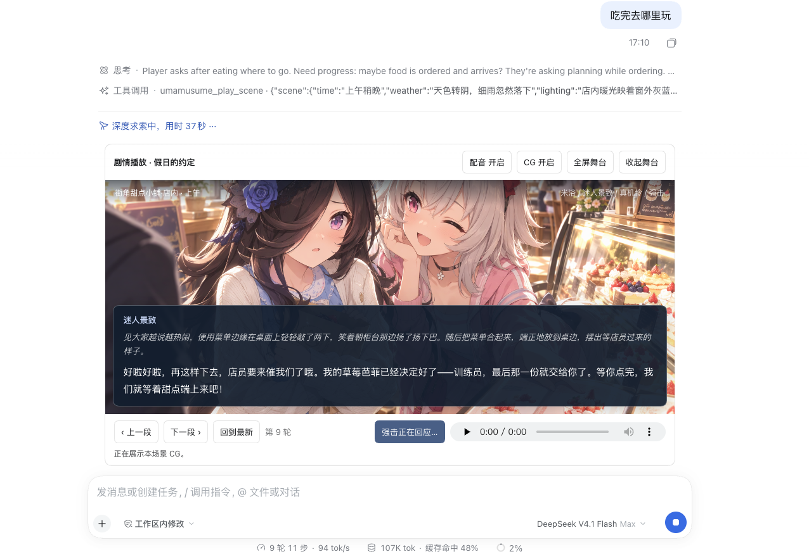
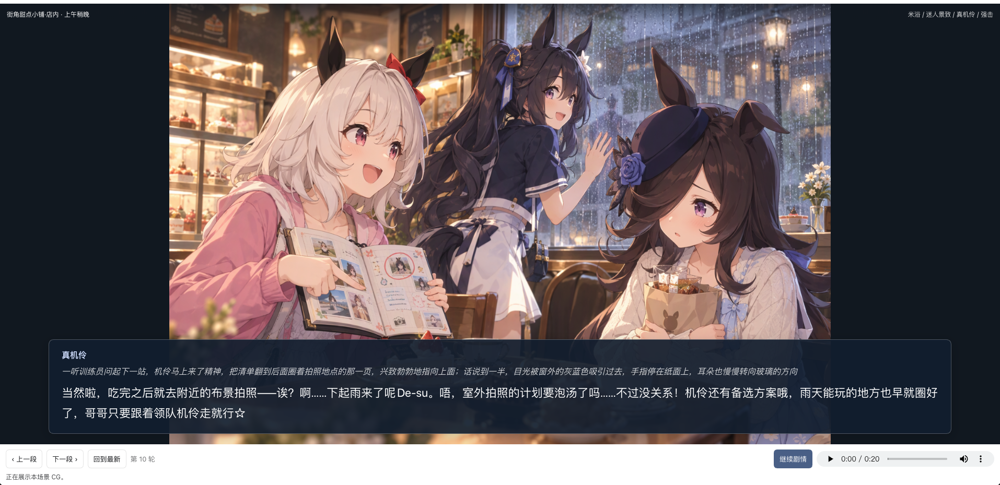

# DSH Umamusume Agent

在 **DeepSeek Harness** 里，与赛马娘聊天，或一起经历一段可以参与的故事。

写下剧情大纲，选好出演角色，以训练员的身份加入对话。导演根据你的回应安排角色互动，在关键时刻生成 CG，再用角色各自的音色为台词配音——像一部由你参与推进的互动视觉小说。



## 可以怎么玩

- **单角色对话**：选择喜欢的赛马娘，自由聊天、训练或扮演日常故事。
- **多人剧情**：支持 1–4 位固定角色。给出开场和大纲，导演安排谁回应、如何推进；每轮结束后等待你参与。
- **角色配音**：角色使用各自的参考音色，支持中文对白、日语配音。语音在后台合成，服务暂时不可用也能继续剧情。
- **剧情 CG**：根据当前场景生成画面，支持多角色参考图、绘图进度和失败重试。
- **全屏舞台**：放大 CG 与对白，按原图比例完整看图；可隐藏对白、回看台词、播放配音，按 Esc 返回聊天。

对话模型使用 Harness 中选择的模型；配音与图像服务按需配置。单角色模式还支持网页搜索和本地剧情检索。



## 开始你的故事

安装配置后，新建会话，在 Agent 模式中选择 **“剧情播放”**。

1. 填写故事标题，选择 **1–4 位出演角色**。
2. 填写大家都知道的“公开开场”，以及只供导演参考的“剧情大纲”。大纲可以留空，也可以写下期待的事件、冲突与情绪方向。
3. 点击“保存故事”，再点击“开始剧情”，或直接在下方聊天框输入训练员的第一句台词。
4. 角色回应后，在下方聊天框继续说话或描述行动。**“继续剧情”只推进一轮**，不会替你说话或无限自动播放。

例如：

> **假日的约定**
>
> 公开开场：假日早晨，米浴、迷人景致、真机伶和强击在特雷森学院门口等训练员，准备一起出门。
>
> 剧情大纲：大家各自准备了想去的地方，却发现一天的时间不够。途中遇到下雨或店铺休息的小插曲，一起调整计划，在相处中发现比行程更重要的是共同度过的时间。根据训练员的选择发展，不替玩家决定台词和行动。

导演每轮通常安排一位角色回应，必要时最多三位依次发言。角色拥有各自的对话上下文，只接收已经公开的事件和本轮表演方向，完整大纲只供导演参考。故事开始后出演名单、开场和大纲锁定；更换设置请新建故事。

舞台上的“上一段 / 下一段”用于回看，“全屏舞台”用于放大画面。配音播放器跟随当前台词，不自动播放。想回应角色时，退出全屏后在下方聊天框输入即可。

## 配音与 CG：可以边聊边等

开启配音后，角色回复会在后台排队合成。**TTS 失败不会阻止剧情推进。** 服务恢复后，回到失败的那段台词，点击 **“重新生成配音”** 即可补做；配音仍对应原角色、原台词与原轮次，不会重新演一遍剧情。单角色模式的配音失败提示旁也有这个按钮。

图像 API 已配置时，故事默认开启 CG。导演可在关键时刻提出绘图；开场与地点、时间切换时，程序也会补齐遗漏的请求，至少间隔三轮。CG 在后台完成，舞台显示进度；可以点击“绘制当前场景”补图，失败后点击“重试这张 CG”。

图片与语音通过 Harness 附件保存在对应回复下，已有剧情与媒体可随会话恢复。详细分工与缓存策略见[剧情播放说明](docs/director-mode.md)。

## 只想与一个角色聊天

新建会话，选择 **“赛马娘”** 模式，在输入框上方搜索并选择角色，然后直接发送训练员的台词。第一条消息前可以更换角色，开始后锁定。

点击 **TTS 开启/关闭** 控制当前会话的自动配音。配置图像服务后，可以直接说“画一张你在训练场跑步的图片”。底部面板显示最新配音任务的进度、播放与下载控件。

## 安装与配置

### 1. 安装 DeepSeek Harness

按照 [DeepSeek Harness 官方说明](https://github.com/deepseek-ai/deepseek-harness)安装并打开 Desktop。

选择一种对话模型来源：

- 登录 **DeepSeek 账号**，使用账号提供的模型。
- 配置 **OpenCode Go 套餐**，在模型选择器中使用官方 `opencode-go` 路由。

插件复用 Harness 的模型路由，不需要另外配置对话模型。OpenCode Go 的使用范围见[官方说明](https://opencode.ai/docs/go/)。

### 2. 安装本插件

在 Desktop 打开“插件”→“添加插件”，输入以下任意一种来源：

- 本仓库的 GitHub 地址。
- clone 后的本地目录绝对路径。例如：

  ```bash
  git clone <本仓库的 GitHub 地址>
  ```

  然后在插件安装框中填写 clone 得到的 `dsh-umamusume-agent` 目录路径。

本地路径方式可先复制 `.env.example` 为 `.env`，完成配置后再安装。安装或更新后，请完全重启 Desktop。

兼容已验证的 Harness `0.2.1-rc.2` 和 `0.2.2-rc.1`。升级 Harness 后若旧插件提示 `ctx.tools.presentAs is not a function`，请更新本插件并完全重启 Desktop，再打开原会话即可，无需重新创建故事。

### 3. 配置语音和图像服务

推荐在 `~/.dsh/.env` 中填写配置；自定义了 `DSH_HOME` 时，改为 `$DSH_HOME/.env`。也可以给 clone 的仓库根目录放置 `.env`，但 Desktop 的全局配置更稳定。

不使用图片生成时，仅配置 FishSpeech 即可：

```dotenv
TTS_ENABLED=false
TTS_PROVIDER=fishspeech
TTS_LANGUAGE=ja
TTS_API_BASE_URL=http://127.0.0.1:8002
TTS_MODEL=s2-pro
TTS_API_KEY=
```

本机 FishSpeech 不需要 API Key，保持 `TTS_API_KEY` 为空。`TTS_ENABLED=false` 表示新会话默认不自动配音，之后可以在会话内随时开启。`TTS_LANGUAGE=ja` 时，角色仍以中文回复，但配音使用日语。

图片生成是可选功能。需要使用 OpenAI 兼容的图像端点时，继续配置：

```dotenv
GENIMG_API_BASE_URL=https://api.openai.com/v1
GENIMG_MODEL=gpt-image-2
GENIMG_API_KEY=你的图像API密钥
```

请按自己的端点修改地址、模型和密钥。修改配置后完全重启 Desktop。完整配置见[配置参考](docs/configuration.md)。

### 4. 部署 FishSpeech TTS（可选）

不需要语音时可以跳过本节。

可以使用 [quantumxiaol/fish-speech](https://github.com/quantumxiaol/fish-speech)。按照该仓库说明下载 S2-Pro 权重并安装环境，建议准备 **16GB 或以上显存**；Apple Silicon 需要足够的统一内存。

在 fish-speech 仓库目录中激活环境，然后启动服务：

```bash
fish-tts-server \
  --host 127.0.0.1 \
  --port 8002 \
  --llama-checkpoint-path ./modelsweights/s2-pro \
  --decoder-checkpoint-path ./modelsweights/s2-pro/codec.pth \
  --storage-root ./storage/fish_speech_service \
  --device mps \
  --dtype float16 \
  --max-seq-len 4096
```

该示例使用 Apple Silicon 的 MPS。其他显卡请按照 FishSpeech 文档调整 `--device` 和 `--dtype`。保持服务运行，插件会通过 `http://127.0.0.1:8002/v1/chat/completions` 调用它；本机推理可能需要一些时间。

## 更多文档

- [完整配置：图片、搜索与本地剧情检索](docs/configuration.md)
- [剧情播放与多角色上下文](docs/director-mode.md)
- [架构、开发与发布说明](docs/development.md)
