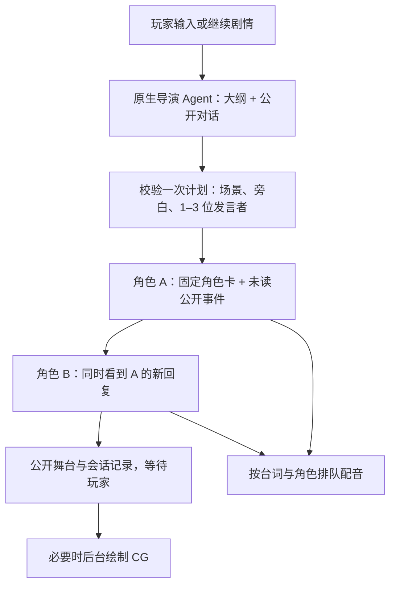

# 剧情播放

“剧情播放”（`umamusume-director`）是独立的互动剧情预设。“赛马娘”（`umamusume`）继续负责原来的单角色对话。两个模式都使用 Harness 的模型选择、会话日志、取消和附件服务。

## 开始一个故事

新建会话并选择“剧情播放”，在输入区上方保存标题、1–4 位角色、公开开场与可选大纲，再点击“开始剧情”。开场最多 2000 字，大纲最多 12000 字。大纲应描述想探索的事件和情绪方向，不要求预先写完整台词。

面板高度有限时，在“剧情播放”面板内向下滚动即可看到“公开开场”“剧情大纲”和“保存故事”。最下方的 Harness 聊天框用于故事开始后的玩家台词与行动；大纲请填写在面板的专用栏位。

例如：

> 开场：傍晚训练结束，米浴与东海帝皇在看台旁等训练员。
>
> 大纲：大家讨论一场即将到来的接力赛。米浴担心拖累队友，帝皇起初试图用自信鼓励她；通过训练员的选择，逐渐发现两人对“可靠队友”的理解不同。希望最后形成一个由大家共同决定的训练约定，不强制完成比赛或某个结局。

每次玩家输入只推进一轮，通常一位角色回复，必要时最多三位。后发言者看到先前角色已经完成的公开表演。玩家可以直接输入台词、动作或剧情事件；“继续剧情”仅允许环境与角色自然推进一步。

第一条玩家消息后固定出演名单、开场与大纲。舞台提供最近 80 条公开事件范围内的回看；更早的文字和媒体继续保留在 Harness 会话历史中。保存设置不会调用对话、TTS 或图像付费接口。

点击“全屏舞台”可让 CG 或角色立绘铺满窗口。CG 保持原图比例，不裁切；“隐藏对白”可以收起文字遮挡。全屏内仍可翻页、播放配音和继续剧情，切换大小保留当前台词与配音进度。按 Esc 或“返回对话”退出后，在下方聊天框输入你的回应。

## 分工与请求数量



导演通过唯一的剧情工具提交计划，程序验证角色名单、人数和重复发言。工具结束本轮，不再追加一次导演改写。角色通过宿主 `ctx.llm` 使用当前会话的模型路由，每位角色拥有独立、持久化的上下文和稳定请求身份，不必逐轮创建临时 Agent。

导演预设固定使用原生工具调用，模型只看到 `umamusume_play_scene` 的参数定义，执行层也拒绝其他工具。预设加载后，会话必须能继承这个工具；如果定义缺失，请求会明确报错，不让模型猜测调用格式。集成测试通过实际预设注册器挂载会话，覆盖宿主的 native 和 PTC 两种工具模式。

普通一轮的对话模型请求为 **1 次导演 + N 次角色**（N 为 1–3）。角色在同一次请求中输出自己的动作、中文对白和配音文本；日语配音不再追加逐句翻译请求。只有低频的上下文压缩会增加记忆整理请求。

CG 使用独立后台图像任务。导演给出画面方向，程序加入当前环境和角色参考图后调用已配置的图像端点；开启 CG 后，如果导演遗漏画面请求，程序会在首次完成表演、地点或时间切换时根据本轮公开表演补齐，仍遵守三轮间隔。没有额外的文本策划模型请求。角色没有工具权限，也不共享彼此的隐藏表演方向。

## 前缀缓存与记忆

- 导演前缀固定为规则、简短出演名单、开场和完整大纲，不塞入全部角色卡；主会话压缩继续使用 Harness 原生能力。
- 每个角色首次表演时固定自己的完整角色卡、公开开场、称呼规则和输出约定。大纲不进入角色线程。
- 平时只在各自历史尾部追加未读公开事件和本轮意图。第一包携带完整环境，以后只携带变化字段。角色回复保留实际返回的 JSON 文本，避免每轮重新序列化旧回复。
- 导演的服装、道具字段支持文字或角色/位置到文字的对象；对象先按键排序并统一成字符串，再写入环境与角色上下文。兼容已有字符串状态，避免同一明细仅因对象顺序变化而产生环境更新。
- 成功的请求、回复、读取位置及公开台词作为一条完整交换记录一起持久化。重启后恢复相同前缀和请求身份；未完成或格式错误的输出不会冒充已经发生的剧情。
- 默认在角色上下文估算达到 60000 字符前检查压缩，并依据宿主报告的模型窗口下调预算，预留输出空间。这是保守字符预算，不是精确 token 计数。
- 压缩只总结已发生的公开事件，按有界批次更新记忆，保留当前轮原文与完整环境，不将隐藏导演意图或未来大纲写进角色记忆。长期未发言角色的未读旧事件也会纳入检查。原始事件保留；只有完整生成并验证下一段回复后才安装新的上下文检查点。
- 模型窗口仍不足或摘要失败时停止本轮，保留原记录；不静默截断台词或反复重试。

前缀稳定是缓存命中的前提，实际命中率取决于供应商、模型、路由和缓存保留时间。角色交换日志记录宿主返回的 `usage`，包括可用时的 `cacheReadTokens`；未报告该字段时不推算命中率。自动测试校验连续请求与重启恢复后的前缀相等，不宣称固定命中百分比。

## TTS 与 CG

沿用现有 `.env` 配置，无需额外对话模型密钥。会话中的配音开关沿用 `TTS_ENABLED` 的新会话默认值。

每段对白使用实际发言角色的参考音频与参考文本。语音任务携带稳定台词 ID 和原始轮次；即使用户已经继续下一轮，音频也交付到原来的回复。播放器跟随舞台当前台词，不强制自动播放。系统不会把旁白或玩家输入自动配成某个角色的声音。

配音服务不可用时，失败状态不会阻止后续剧情。服务恢复后，用“上一段 / 下一段”回到失败台词，点击“重新生成配音”；普通舞台和全屏舞台都支持。任务会重新排队，只合成这一段，完成后替换该台词的失败状态，不增加剧情轮次。只有失败任务可以重试，已排队和已完成的任务不会重复提交；再次失败时仍需手动重试。

新任务持久化原角色、台词、已准备的日语文本和原轮次，重启后也能重试。旧版剧情任务可从原始角色表演记录恢复台词与配音文本；缺少日语文本时单独翻译，不重新生成角色回复。命令入口为 `/uma tts retry <任务ID>`，需要先开启当前会话配音。

配置了图像端点时，新保存的故事默认允许 CG，可在面板关闭。每轮至多提出一张，至少间隔三轮；相同画面请求去重，生成失败不自动重复收费。重试按钮只重试指定的失败任务。关闭 CG 会阻止新任务，并取消尚未开始的排队请求；已经发出的图像请求可能完成。

面板分别显示尚未绘制、排队、绘制中、完成和失败状态。已有剧情没有 CG 时，可点击“绘制当前场景”，直接根据最近完成的一轮补图，不推进剧情、不增加角色模型调用；同样遵守去重和三轮间隔。失败画面使用“重试这张 CG”，不会因继续对话而自动重试。回看时只显示对应场景和不晚于所选轮次的图片与错误。

多人 CG 将对应立绘作为多个 `image[]` 参考图提交，单图继续使用 `image`。只有编辑端点返回 404 才回退为带角色文字说明的图片生成；其他错误直接显示。自定义网关需要支持相应的多图编辑协议。参考图可以改善一致性，不能保证每次生成的服装和人物细节完全一致。

CG 按完成前捕获的轮次与环境关联。回看旧台词时不会显示未来轮次的 CG；转场后也不会把旧地点的画面当作新场景。图像失败或尚未生成时仍可阅读文字，并使用已有立绘。

停止主回复会停止尚未完成的角色请求，已经公开的台词保留。已为完成台词排队的媒体继续属于该台词。重启后未完成的媒体任务会标为中断，不自动重新收费；故事可接着推进，失败 CG 可手动重试。

## 命令与验证

面板使用以下命令，普通使用不必手写 JSON：

```text
/uma story setup {"title":"训练场的约定","cast":["rice_shower","tokai_teio"],"opening":"傍晚在训练场相遇。","outline":"逐渐建立接力赛的信任与共同约定。"}
/uma story continue
/uma tts on
/uma story cg off
/uma story draw-cg
/uma story retry-cg <失败任务ID>
```

`npm test` 包含导演计划约束、独立上下文、跨轮与重启前缀、原生 Agent 循环、取消和压缩失败、角色音色、异步媒体归属、多参考图、CG 去重及界面渲染测试。测试使用本地模拟响应，不调用付费服务。真实模型的叙事质量、供应商缓存命中以及实际图像／音色效果仍需使用自己的服务体验。
